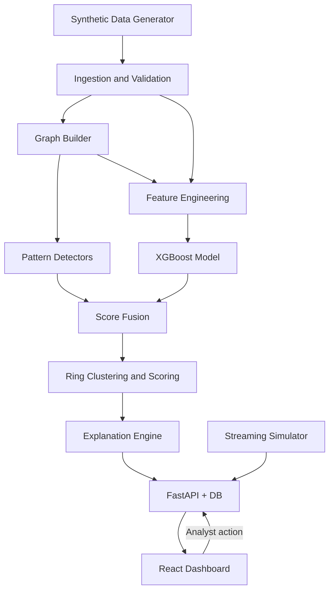

# Mule Account Ring Detection Dashboard
### Hackathon Project Plan: Track 7 (Cybersecurity, FinTech & Digital Trust)

> **Note on facts:** Details about existing solutions (Section 8) come from general knowledge and may be outdated. Verify each one before putting it on a slide.

---

## Table of Contents
1. [Problem and Pitch](#1-problem-and-pitch)
2. [Target Audience](#2-target-audience)
3. [High-Level Architecture](#3-high-level-architecture)
4. [Workflow (End to End)](#4-workflow-end-to-end)
5. [Detailed Procedures and Detection Logic](#5-detailed-procedures-and-detection-logic)
6. [Dashboard Contents](#6-dashboard-contents)
7. [Uniqueness](#7-uniqueness)
8. [Existing Solutions: India and Abroad](#8-existing-solutions-india-and-abroad)
9. [Team Structure and Work Split](#9-team-structure-and-work-split)
10. [Parallel-Work Contracts (Day 1)](#10-parallel-work-contracts-day-1)
11. [15-Day Development Plan](#11-15-day-development-plan)
12. [Evaluation and Metrics](#12-evaluation-and-metrics)
13. [Demo Script (3 Minutes)](#13-demo-script-3-minutes)
14. [Risks and Mitigations](#14-risks-and-mitigations)
15. [Privacy, Ethics and Compliance](#15-privacy-ethics-and-compliance)
16. [Repository Structure and Git Workflow](#16-repository-structure-and-git-workflow)
17. [Stretch Goals](#17-stretch-goals)

---

## 1. Problem and Pitch

**Problem.** When a scam succeeds, the stolen money is rarely kept in one account. It is split across many "mule" accounts (accounts that receive and forward illicit money, often rented, bought, or opened with fake KYC) within minutes. Most bank monitoring looks at **one account at a time**, so each hop looks small and ordinary. By the time one account is frozen, the money has moved on.

**Pitch (two sentences).**
Fraud money is split across many mule accounts within minutes, and per-account rules miss the pattern. Our dashboard builds a transaction graph, detects mule rings by their *network shape*, and shows an analyst the whole ring with a plain-language reason to freeze it.

**Goal for the hackathon.** A working end-to-end prototype on synthetic data that:
- Detects at least four types of mule ring patterns.
- Beats a per-account rule baseline on recall and false positives.
- Shows each ring visually with an explanation and a recommended action.

---

## 2. Target Audience

| Audience | How they use it | What they care about |
|---|---|---|
| **Bank / NBFC fraud operations teams** (primary) | Review alert queue, investigate rings, decide to freeze or escalate | Fewer false positives, faster triage, evidence for decisions |
| **Payment platforms and fintech/UPI apps (PSPs)** | Score accounts and rings in near real time | Latency, integration ease, regulatory comfort |
| **Cyber crime cells / law enforcement** | Follow money trails across institutions | Visual evidence, ring structure, timeline |
| **Regulators and industry bodies** | See system-wide mule patterns | Aggregate trends, explainability |
| **Small banks and co-operative banks** (underserved) | Get graph analytics without an expensive enterprise product | Low cost, simple deployment |

**Primary persona:** *Fraud analyst at a mid-size bank.* She gets hundreds of alerts a day, mostly false. She needs to see which alerts belong to one coordinated ring and act before the money exits.

---

## 3. High-Level Architecture

```
┌─────────────────────────────────────────────────────────────────────┐
│                        DATA LAYER                                   │
│  Synthetic Data Generator  ──►  transactions.csv / accounts.csv     │
│  (normal + hard negatives + planted rings + ground-truth labels)    │
└───────────────────────────────┬─────────────────────────────────────┘
                                ▼
┌─────────────────────────────────────────────────────────────────────┐
│                      PROCESSING LAYER                               │
│  Ingestion/Validation ──► Graph Builder (NetworkX)                  │
│        │                        │                                   │
│        ▼                        ▼                                   │
│  Feature Engineering ◄── Pattern Detectors (fan-in/out, chains,     │
│  (per-account + graph)       cycles, pass-through, communities)     │
│        │                        │                                   │
│        ▼                        ▼                                   │
│  ML Model (XGBoost) ───► Score Fusion ───► Ring Clustering + Scoring│
└───────────────────────────────┬─────────────────────────────────────┘
                                ▼
┌─────────────────────────────────────────────────────────────────────┐
│                      INTELLIGENCE LAYER                             │
│  Explanation Engine: reason codes (SHAP + rule hits) ─► templated   │
│  case summary ─► optional LLM rewrite in plain language             │
└───────────────────────────────┬─────────────────────────────────────┘
                                ▼
┌─────────────────────────────────────────────────────────────────────┐
│                        SERVICE LAYER                                │
│  FastAPI  +  SQLite/PostgreSQL  (alerts, rings, cases, actions)     │
│  Streaming simulator (replays transactions to mimic real time)      │
└───────────────────────────────┬─────────────────────────────────────┘
                                ▼
┌─────────────────────────────────────────────────────────────────────┐
│                      PRESENTATION LAYER                             │
│  React dashboard: Alert Queue │ Ring Explorer │ Explanation │       │
│  Metrics │ Case Actions                                             │
└─────────────────────────────────────────────────────────────────────┘
```

### Mermaid version (renders on GitHub and many viewers)



### Component summary

| Component | Responsibility | Tech |
|---|---|---|
| Data generator | Create accounts, normal traffic, hard negatives, planted rings, labels | Python, pandas, numpy, Faker |
| Graph builder | Build directed, time-stamped, weighted transaction graph | NetworkX |
| Pattern detectors | Rule-based detection of ring shapes | NetworkX, custom Python |
| Feature engineering | Account-level and neighborhood features | pandas, NetworkX |
| ML model | Supervised account risk score, baseline comparison | XGBoost / scikit-learn |
| Ring scorer | Cluster flagged accounts into rings; score each ring | NetworkX (connected components, Louvain) |
| Explanation engine | Reason codes and case summaries | SHAP, templates, optional LLM API |
| API | Serve alerts, rings, graphs, metrics; accept analyst actions | FastAPI, Pydantic |
| Storage | Persist results and actions | SQLite (dev), PostgreSQL (optional) |
| Dashboard | Analyst UI | React + Cytoscape.js (or Streamlit fallback) |
| DevOps | Run everything with one command, deploy a demo | Docker Compose, GitHub Actions |

---

## 4. Workflow (End to End)

### 4.1 Offline / batch workflow
1. **Generate data:** accounts, transactions, and planted rings with labels.
2. **Validate and load:** check schema, timestamps, and amounts; write to the database.
3. **Build graph:** nodes are accounts; edges are transfers with amount and time.
4. **Compute features:** per-account stats and graph features over rolling windows.
5. **Run detectors and model:** rule hits plus ML probability.
6. **Fuse scores:** combine into a single account risk score (0-100).
7. **Cluster into rings:** group high-risk, connected accounts; compute ring score.
8. **Explain:** generate reason codes and a plain-language summary.
9. **Publish:** store alerts and rings; the dashboard reads them via the API.

### 4.2 Simulated real-time workflow (for the live demo)
1. The streaming simulator replays transactions in time order at an accelerated speed.
2. A sliding window (for example, last 60 minutes) updates the graph incrementally.
3. When a detector's confidence crosses a threshold, a new alert appears in the queue within seconds.
4. The analyst opens the ring, reviews the explanation, and clicks **Recommend Freeze** or **Escalate** or **Mark False Positive**.
5. The decision is logged, and (stretch) feeds back as a label for retraining.

### 4.3 Analyst journey
```
Alert queue → pick top ring → Ring Explorer (graph + replay) → read explanation
→ check evidence (victim accounts, amounts, timing) → take action → case logged
```

---

## 5. Detailed Procedures and Detection Logic

### 5.1 Data schema (summary; the full version is frozen on Day 1)

**accounts**
| Field | Type | Notes |
|---|---|---|
| account_id | string | pseudonymous ID |
| open_date | date | account age is a signal |
| kyc_level | enum | minimal / full |
| account_type | enum | savings / current / wallet |
| city_cluster | string | coarse location |
| declared_income_band | enum | for profile mismatch |
| is_mule | bool | ground truth (training/eval only) |
| ring_id | string/null | ground truth (eval only) |
| scenario | string | normal / hard_negative / ring type |

**transactions**
| Field | Type | Notes |
|---|---|---|
| txn_id | string | |
| ts | datetime | |
| src_account | string | |
| dst_account | string | |
| amount | float | INR |
| channel | enum | UPI / IMPS / NEFT / ATM-withdrawal |
| is_fraud_related | bool | ground truth |

### 5.2 Synthetic data design
- **Scale:** 10,000 to 20,000 accounts, 150k to 500k transactions over 30 days.
- **Normal behavior:** salary credits, rent, merchant payments, peer transfers, bill payments with realistic amount distributions (log-normal) and daily/weekly seasonality.
- **Hard negatives** (legitimate accounts that *look* suspicious), included so false positives are tested:
  - Busy shops and kirana stores (high fan-in, but spread of small amounts and cash-out is rare)
  - Landlords and societies collecting rent
  - Payroll disbursers (high fan-out)
  - Crowdfunding or festival collection accounts
  - Family members pooling money
- **Planted ring types** (the system must handle all, to show it is not overfit to one):

| Ring type | Shape | Signature |
|---|---|---|
| **Fan-in → Fan-out** | Many victims → collector → several mules → cash-out | Sudden inflow from many unique senders, then rapid split |
| **Layering chain** | A → B → C → D → E | Near-identical amounts, short delays, decreasing by small "commission" |
| **Circular flow** | A → B → C → A | Money returns to origin to look legitimate |
| **Rapid pass-through hub** | Accounts forwarding ~95-100% within minutes | Near-zero retained balance |
| **Dormant-then-active** | New or long-idle accounts that suddenly move large volumes | Age vs. volume mismatch |

- **Ground truth:** every planted mule and ring is labeled. Add label noise and some unlabeled-but-suspicious accounts to avoid "too perfect" results.
- **Difficulty knobs:** ring size, time spread, amount noise, and number of hops are configurable, so you can show performance as rings get harder to detect.

### 5.3 Graph construction
- Directed multigraph: node = account, edge = transaction (amount, ts, channel).
- Maintain two views:
  - **Full graph** for features and context.
  - **Filtered suspicious subgraph** (edges within time windows, above amount thresholds) for ring finding.
- Time windows: 10 min, 1 hour, 24 hours, 7 days.

### 5.4 Features (per account, per window)

**Volume and flow**
- Total in, total out, net retained ratio
- **Pass-through ratio** = out ÷ in
- **Median time-to-forward** (time from receiving to sending out)
- Transaction count and burstiness (coefficient of variation of inter-arrival time)

**Graph structure**
- In-degree, out-degree, fan-in/fan-out ratio
- Number of **unique counterparties** and share of one-time counterparties
- Participation in **short cycles** (length 3 to 5)
- Participation in **forward chains** with similar amounts
- PageRank / betweenness on the suspicious subgraph (identifies hubs)
- Community ID and community-level aggregates (Louvain)
- Neighbor risk: average risk of direct counterparties (2-hop propagation)

**Profile and behavior**
- Account age vs. transaction volume
- Volume vs. declared income band
- Share of cash-out (ATM / immediate withdrawals)
- Time-of-day pattern (night activity)
- New-beneficiary rate

### 5.5 Rule-based detectors (explainable, fast)
| Detector | Logic (example thresholds; tune them) |
|---|---|
| Fan-in burst | ≥ 10 unique senders within 1 hour and amount above X |
| Rapid pass-through | ≥ 85% of inflow forwarded within 15 minutes |
| Fan-out split | One account sends to ≥ 4 new beneficiaries within 30 minutes of a large inflow |
| Layering chain | Path of ≥ 3 hops where each hop amount is within 3-10% of the previous and delay < 30 minutes |
| Circular flow | Directed cycle of length 3-5 within 24 hours with amount similarity |
| Dormant activation | Account age < 30 days or idle > 90 days, then volume > N times its history |

### 5.6 ML model
- **Task:** account-level binary classification (mule vs. not).
- **Model:** XGBoost on the features above; handle class imbalance with scale_pos_weight and PR-AUC-focused tuning.
- **Splits:** split **by ring and by time**, not randomly, so there is no leakage between train and test.
- **Baseline:** per-account rule engine using only account-level fields (no graph). This is the thing you beat.
- **Explainability:** SHAP values per account become reason codes ("high pass-through ratio, 12 unique senders in 1 hour").
- **Stretch:** a GNN (GraphSAGE) as an experiment; keep it out of the main demo path.

### 5.7 Score fusion
```
account_risk = 0.5 * ml_probability + 0.3 * rule_score + 0.2 * neighbor_risk
(scaled to 0-100; weights tuned on validation data)
```

### 5.8 Ring clustering and ring score
1. Take accounts with `account_risk ≥ threshold`.
2. Connect them through edges in the suspicious subgraph.
3. Each connected component (or Louvain community) with ≥ 3 accounts becomes a **candidate ring**.
4. **Ring score** combines:
   - Mean and max account risk
   - Total money moved and **amount at risk** (money not yet cashed out)
   - Speed (time from first inflow to last outflow)
   - Size and number of distinct victims
   - Pattern diversity (several detectors firing raises confidence)
5. Rank rings by `ring_score × amount_at_risk` so the queue starts with what matters most.

### 5.9 Explanation engine
- **Level 1:** reason codes from rules and SHAP.
- **Level 2:** templated summary, for example:
  > *"7 accounts received ₹4.2 lakh from 23 different senders in 40 minutes and forwarded 96% within 10 minutes. 5 of the 7 accounts are less than 30 days old. Pattern: fan-in → fan-out. Recommended action: temporary freeze and escalate."*
- **Level 3 (optional):** pass the structured facts to an LLM to rewrite as a short case note in English, Hindi, or Telugu. The LLM must only restate the given facts and must never invent numbers.

### 5.10 Action logic
| Ring score | Suggested action |
|---|---|
| High (≥ 80) and amount at risk high | Recommend temporary freeze and escalate to investigator |
| Medium (50-79) | Add to watchlist, request manual review |
| Low (< 50) | Monitor |

A human always confirms. The system only recommends.

---

## 6. Dashboard Contents

### 6.1 Home / Overview
- KPI cards: active alerts, rings detected today, total amount at risk, money saved (simulated), average time-to-detect
- Trend chart: alerts over time by ring type
- Top 5 rings by priority

### 6.2 Alert Queue
- Sortable and filterable table: ring ID, ring score, type, number of accounts, amount at risk, time detected, status
- Filters: ring type, score range, status, date
- Status workflow: New → Under review → Frozen / Escalated / False positive

### 6.3 Ring Explorer (main demo screen)
- Interactive graph (Cytoscape.js):
  - Node color = role (victim, collector, mule, cash-out)
  - Node size = money handled
  - Edge thickness = amount; arrow = direction
- **Timeline slider and Play button** to replay how money moved
- Click a node: account profile, features, risk score, reason codes
- Click an edge: transaction details
- Toggle layers: show victims, show only suspicious edges, show 2-hop context
- Money-flow summary (inflow, outflow, retained, cashed out)

### 6.4 Explanation Panel
- Plain-language case summary
- Pattern tags (for example: fan-in, rapid pass-through)
- Top reason codes with importance bars (SHAP)
- Language selector (English / Hindi / Telugu) for the summary (stretch)

### 6.5 Case Actions
- Buttons: Recommend Freeze, Escalate, Mark False Positive, Add Note
- Audit log of who did what and when
- Export case report as PDF / CSV for investigators

### 6.6 Metrics Tab
- Precision, recall, F1, false-positive rate, PR curve
- **Comparison: per-account baseline vs. our graph method**
- Recall by ring type and by difficulty level
- Time-to-detect distribution
- Confusion matrix and a hard-negative false-positive breakdown

### 6.7 Simulation Control (demo helper)
- Start / pause / speed of the transaction stream
- "Inject new ring" button to demo live detection

---

## 7. Uniqueness

1. **Network-level detection, not account-level.** Finds the *ring*, shows its whole structure, and ranks by amount still recoverable.
2. **Multi-pattern coverage.** Fan-in/fan-out, chains, cycles, pass-through, and dormant activation in one engine, with performance reported per pattern.
3. **Explainability first.** Every alert has reason codes and a plain-language summary an analyst or court-facing investigator can understand. This addresses the "black box" objection that stops many banks from adopting ML.
4. **Hard-negative evaluation.** We deliberately test against legitimate busy accounts (shops, landlords, payroll) and report false positives openly.
5. **Time-replay of money movement.** Analysts see *how fast* money moved, which explains urgency.
6. **Amount-at-risk prioritization.** The queue is ranked by money that can still be stopped, not just by score.
7. **Lightweight and affordable.** Runs on open-source tools, so it fits small and co-operative banks that cannot afford enterprise suites.
8. **Regional-language case summaries (stretch).** Useful for cyber cells and regional bank branches.
9. **Privacy-aware design.** Pseudonymized IDs, human-in-the-loop, audit trail.

---

## 8. Existing Solutions: India and Abroad

### 8.1 India

| Solution | Who | What it does | Gap we address |
|---|---|---|---|
| **MuleHunter.AI** | RBI Innovation Hub (RBIH) with banks | AI/ML model to flag mule accounts for banks | Primarily bank-side account scoring; our focus is ring visualization and analyst explainability |
| **Citizen Financial Cyber Fraud Reporting and Management System + 1930 helpline** | I4C, Ministry of Home Affairs | Victims report fraud; banks are alerted to put holds on the money | Reactive and report-driven; relies on the victim reporting quickly |
| **Financial Fraud Risk Indicator (FRI)** | Department of Telecommunications | Flags mobile numbers linked to fraud risk to help banks and UPI apps | Phone-number-level signal, not transaction network structure |
| **Sanchar Saathi / Chakshu** | DoT | Report suspected fraud communication, block misuse of connections | Telecom side, not money-trail analysis |
| **NPCI fraud monitoring and risk tools for UPI** | NPCI | Transaction-level risk checks across UPI | Centralized and not an analyst-facing ring tool for individual banks |
| **Bank in-house rule engines** (various private/public banks) | Banks | Rules and thresholds on single accounts | High false positives; miss distributed patterns |
| **Commercial vendors operating in India** (for example, Mastercard, Visa, FICO, NICE Actimize, SAS, and Indian fraud-tech startups) | Enterprise vendors | Real-time scoring, case management | Costly; opaque to small institutions |

### 8.2 Abroad

| Solution / Initiative | Region | What it does | Gap we address |
|---|---|---|---|
| **Featurespace (ARIC)** | UK / global | Behavioral anomaly detection for payments fraud | Enterprise licensing; not focused on lightweight ring explainability for small banks |
| **BioCatch** | Israel / global | Behavioral biometrics (how a user types, swipes) to catch scams and mule accounts | Device behavior, not the transaction graph |
| **Feedzai, NICE Actimize, SAS, FICO Falcon** | Global | Enterprise fraud and AML platforms | Expensive and heavy; closed models |
| **Quantexa** | UK / global | Entity resolution and network analytics for financial crime | Powerful but enterprise-scale |
| **Neo4j-based graph fraud solutions and TigerGraph** | Global | Graph databases used for fraud-ring analytics | Platforms, not ready-made mule-ring products |
| **Mastercard Consumer Fraud Risk / Mastercard mule-detection offerings** | UK / global | Scores payments and flags likely mule recipients across banks | Network-owned; available to member banks only |
| **UK Confirmation of Payee and APP-fraud reimbursement regime** | UK | Name checks on payee accounts; banks share liability for push-payment scams | Policy and name matching, not ring discovery |
| **Transaction Monitoring Netherlands (TMNL)** | Netherlands | Joint transaction monitoring by multiple banks to see cross-bank criminal networks | Consortium model; our design shows a path for cross-institution graphs |
| **COSMIC** | Singapore (MAS) | Platform for banks to share risk information on suspicious customers | Information sharing; we complement with detection and visualization |
| **Scam-Safe Accord / Scams Prevention Framework** | Australia | Industry commitments and rules to detect and disrupt scams and mule accounts | Framework-level, not a tool |
| **FinCEN mule-account advisories and the US Early Warning / Zelle fraud tools** | USA | Guidance and network-level fraud signals | Fragmented across institutions |

### 8.3 Where we position ourselves
- **Not** competing with enterprise suites; we offer an **open, explainable, low-cost** ring-detection layer a smaller bank could adopt.
- Our design points to an **industry-level future**: if multiple banks shared pseudonymized graph signals (as in the Netherlands and Singapore), detection would improve further. This is our "what next" slide.

> Verify names, current availability, and scope of each initiative before presenting.

---

## 9. Team Structure and Work Split

Six members, six mostly independent streams. Each person owns a module and a folder in the repo.

| # | Role | Owns | Main deliverables |
|---|---|---|---|
| **M1** | **Data Engineer** | Synthetic data and ground truth | Generator, ring templates, hard negatives, difficulty knobs, data docs, streaming simulator |
| **M2** | **Graph and Detection Engineer** | Graph builder, pattern detectors, ring clustering | Graph module, six rule detectors, ring clustering, ring scoring |
| **M3** | **ML Engineer** | Features, model, evaluation | Feature pipeline, baseline, XGBoost, SHAP, metrics scripts, evaluation report |
| **M4** | **Backend and DevOps Engineer** | API, database, integration, deployment | OpenAPI contract, mock server, FastAPI, DB schema, Docker Compose, CI, deployment |
| **M5** | **Frontend Lead** | Dashboard core | Alert queue, Ring Explorer graph, timeline replay, overview page |
| **M6** | **Explainability, Frontend Support and Pitch Lead** | Explanation engine, metrics tab, case actions, pitch | Reason codes, summary templates, LLM rewrite, metrics and case UI, deck, video, documentation |

### Why this runs in parallel
- Everyone starts Day 2 against **frozen contracts** (Section 10): data schema, API spec, JSON fixtures.
- **M5 and M6** build the UI against a **mock API** from M4 and **fixture files**, so they never wait for real detection.
- **M3** can start with a small sample dataset M1 ships on Day 2 and later swaps in the full one.
- **M2** works against the same schema and tests on the sample data and tiny hand-made graphs.
- **M4** integrates modules as plug-in functions with agreed signatures.

### Pairing and backup
| Primary | Backup |
|---|---|
| M1 | M3 (data), M4 (simulator) |
| M2 | M3 |
| M3 | M2 |
| M4 | M5 |
| M5 | M6 |
| M6 | M5 |

---

## 10. Parallel-Work Contracts (Day 1)

All six agree on and commit these on Day 1 so work can truly proceed in parallel.

### 10.1 Data contract
- `docs/data_schema.md` with exact fields and types (Section 5.1)
- A **10-account, 30-transaction toy sample** and a 500-account sample file (M1 delivers the larger sample by end of Day 2)

### 10.2 Module interface contracts (Python)
```python
# M2
def build_graph(accounts_df, txns_df, window=None) -> nx.MultiDiGraph: ...
def run_detectors(graph) -> list[DetectorHit]: ...
def cluster_rings(graph, account_scores) -> list[Ring]: ...

# M3
def compute_features(accounts_df, txns_df, graph) -> pd.DataFrame: ...
def train_model(features_df, labels) -> Model: ...
def score_accounts(model, features_df) -> pd.DataFrame  # account_id, ml_prob, shap_top_reasons

# M6
def explain_ring(ring, account_scores, detector_hits) -> Explanation
```

### 10.3 API contract (M4 publishes `openapi.yaml` on Day 1-2)
| Endpoint | Purpose |
|---|---|
| `GET /alerts` | List rings/alerts with filters and sorting |
| `GET /rings/{ring_id}` | Ring details: accounts, edges, scores, explanation |
| `GET /rings/{ring_id}/timeline` | Time-ordered transactions for replay |
| `GET /accounts/{account_id}` | Profile, features, reason codes |
| `POST /rings/{ring_id}/action` | Freeze / escalate / false positive / note |
| `GET /metrics` | Precision, recall, FPR, baseline comparison |
| `POST /simulation/start` / `pause` / `inject_ring` | Demo controls |

### 10.4 JSON fixtures
Handwritten example responses for every endpoint in `fixtures/`, one for each ring type. The mock server and the frontend use these until the real pipeline is ready.

### 10.5 Working agreements
- Branch per feature; PRs reviewed by one teammate; `main` is always runnable.
- Daily 15-minute stand-up; a weekly (Day 5, 10) integration check.
- Conventional commit messages; one shared task board (GitHub Projects or Trello).
- Interface changes require a message in the group chat and an update to the contract docs.

---

## 11. 15-Day Development Plan

**Phases:** Setup (D1-2) → Build (D3-8) → Integrate (D9-11) → Polish and evaluate (D12-13) → Pitch and rehearse (D14-15)

### Overview

| Day | Phase | Milestone |
|---|---|---|
| 1 | Setup | Scope locked, contracts frozen, repo and board ready |
| 2 | Setup | Sample data, mock API and fixtures live, dev environments running |
| 3-4 | Build | Generator v1, graph builder, first features, UI skeleton |
| 5 | Checkpoint | **Integration check 1:** sample data → graph → mock UI wired where possible |
| 6-8 | Build | Detectors, baseline and model v1, real API, graph explorer and queue |
| 9 | Integrate | Real pipeline connected to API; dashboard on real data |
| 10 | Checkpoint | **Integration check 2:** full end-to-end run on full dataset |
| 11 | Integrate | Explanations, actions, metrics wired in |
| 12 | Polish | Tuning, false-positive reduction, UI polish |
| 13 | Evaluate | Final metrics, ablations, bug bash, feature freeze |
| 14 | Pitch | Deck, demo video, README; full dry-run |
| 15 | Buffer | Final rehearsal, deployment check, submission |

### Detailed per-person schedule

#### M1: Data Engineer
| Day | Tasks |
|---|---|
| 1 | Finalize schema with team; write ring-type specifications and parameter lists |
| 2 | Generator v0: normal accounts and transactions; ship 500-account sample + toy sample |
| 3 | Add planted rings: fan-in/fan-out and layering chain; write labels |
| 4 | Add circular flow, pass-through hub, dormant-activation rings |
| 5 | Add hard negatives (shops, landlords, payroll, collections); integration check |
| 6 | Difficulty knobs and noise; reproducible seeds; generate full dataset v1 |
| 7 | Streaming simulator (time-ordered replay with speed control) |
| 8 | Data validation scripts and data card documentation; generate test sets (new seeds, harder rings) |
| 9 | Support integration: fix data issues found by M2/M3/M4; produce "demo dataset" with curated, visually clear rings |
| 10 | Integration check; generate dataset v2 with feedback |
| 11 | "Inject ring" function for live demo |
| 12 | Stress-test performance with larger data (500k+ transactions); optimize |
| 13 | Help with evaluation sets, edge cases |
| 14 | Help with the deck (data section), demo video capture |
| 15 | Final rehearsal, buffer |

#### M2: Graph and Detection Engineer
| Day | Tasks |
|---|---|
| 1 | Finalize function signatures; research graph algorithms |
| 2 | Graph builder on toy/sample data; unit tests with hand-made graphs |
| 3 | Fan-in burst and fan-out split detectors |
| 4 | Rapid pass-through and dormant activation detectors |
| 5 | Layering chain detector; integration check |
| 6 | Cycle detector (length 3-5 with time and amount constraints) |
| 7 | Community detection and ring clustering |
| 8 | Ring scoring (money moved, speed, size, amount at risk); roles (victim/collector/mule/cash-out) |
| 9 | Plug into API pipeline; performance optimization (time windows, incremental updates) |
| 10 | Integration check; incremental graph update for streaming |
| 11 | Tune thresholds with M3 using validation set |
| 12 | Reduce false positives on hard negatives; add edge-case handling |
| 13 | Final detector tests; document each detector's logic and parameters |
| 14 | Prepare the technical-depth slide and Q&A notes |
| 15 | Buffer and rehearsal |

#### M3: ML Engineer
| Day | Tasks |
|---|---|
| 1 | Finalize feature list and evaluation protocol (splits by ring/time) |
| 2 | Per-account baseline rule engine on sample data |
| 3 | Volume/flow features (pass-through, time-to-forward, burstiness) |
| 4 | Graph-structure features (degree, unique counterparties, cycles, community aggregates) |
| 5 | Feature pipeline function; integration check; first model on sample data |
| 6 | Full-dataset training; handle class imbalance; XGBoost v1 |
| 7 | Evaluation harness: precision, recall, FPR, PR-AUC, per-ring-type recall |
| 8 | SHAP reason codes; neighbor-risk (2-hop) feature; score-fusion function |
| 9 | Plug into pipeline; export scores for API |
| 10 | Integration check; evaluate on held-out harder dataset |
| 11 | Tune fusion weights and thresholds with M2 |
| 12 | Ablation study (baseline vs. rules vs. ML vs. fusion); calibration |
| 13 | Final metrics tables and plots; evaluation report |
| 14 | Prepare the results slide; write limitations section |
| 15 | Buffer and rehearsal |

#### M4: Backend and DevOps Engineer
| Day | Tasks |
|---|---|
| 1 | Draft OpenAPI spec; repo structure; Docker skeleton |
| 2 | **Mock API server serving fixtures**; publish to frontend; DB schema |
| 3 | FastAPI project with endpoints returning fixtures; Pydantic models |
| 4 | Database layer (SQLite/PostgreSQL); loaders for accounts, transactions, scores |
| 5 | Pipeline runner (data → graph → features → scores → rings → DB); integration check |
| 6 | Implement `/alerts`, `/rings/{id}`, `/accounts/{id}` with real data |
| 7 | `/timeline`, `/metrics`, `/action` endpoints; audit log |
| 8 | Simulation endpoints; WebSocket or polling for live alerts |
| 9 | Full integration; end-to-end run via one command |
| 10 | Integration check; CI (lint, tests); logging and error handling |
| 11 | Performance: caching, pagination; authentication (simple token) if time |
| 12 | Docker Compose for the whole stack; deployment to a cloud/VM or local demo setup |
| 13 | Backup plan: offline demo bundle; load test |
| 14 | README, setup instructions, API docs; deployment verification |
| 15 | Final deployment check; buffer |

#### M5: Frontend Lead
| Day | Tasks |
|---|---|
| 1 | Wireframes with M6; choose stack (React + Vite + Cytoscape.js); design tokens |
| 2 | Project scaffold; connect to mock API |
| 3 | Alert Queue page (table, sort, filter) using fixtures |
| 4 | Ring Explorer v1: render graph with roles, sizes, edge widths |
| 5 | Node/edge click panels; integration check |
| 6 | Timeline slider and Play replay animation |
| 7 | Overview page (KPI cards, trend chart) |
| 8 | Layer toggles, layouts for clarity, performance on larger rings |
| 9 | Switch from mock to real API; fix data-shape issues |
| 10 | Integration check; live alert updates in queue (streaming demo) |
| 11 | Simulation control panel (start, speed, inject ring) |
| 12 | UI polish: colors, loading states, responsive layout, dark mode (optional) |
| 13 | Usability test with 3-5 outsiders; fix top issues |
| 14 | Record demo footage with M6; final visual polish |
| 15 | Buffer and rehearsal |

#### M6: Explainability, Frontend Support and Pitch Lead
| Day | Tasks |
|---|---|
| 1 | Write problem narrative and persona; wireframes with M5; explanation template design |
| 2 | Explanation templates and reason-code dictionary; user-story list |
| 3 | Explanation engine v1 on fixtures (rules-based summary) |
| 4 | Explanation Panel UI component; Case Actions UI (buttons, notes, audit log view) |
| 5 | Metrics Tab UI with placeholder charts; integration check |
| 6 | Report export (PDF/CSV of a case); start the pitch deck structure |
| 7 | LLM rewrite step with strict fact-grounding; fallbacks when API unavailable |
| 8 | Language support for summaries (Hindi/Telugu) if time; review quality with a native speaker |
| 9 | Wire explanation engine to real ring outputs; wire Metrics Tab to real `/metrics` |
| 10 | Integration check; review explanations for correctness against ring facts |
| 11 | Finalize deck draft; competitor/solution comparison slide (Section 8 content, verified) |
| 12 | Write the demo script and Q&A document (hard questions on privacy, scale, real data) |
| 13 | Record backup demo video; final deck revision |
| 14 | Full team dry-run with timing; refine story |
| 15 | Final rehearsal; submission package |

### Dependency map (what can block whom, and the workaround)

| Dependency | Workaround |
|---|---|
| Frontend needs real data | Mock API plus fixtures from Day 2 |
| ML needs full dataset | 500-account sample on Day 2; full set by Day 6 |
| Detectors need ground truth | Hand-made graphs and the sample set |
| API needs detectors and model | API returns fixtures first; swap in real function calls as each lands |
| Explanations need ring outputs | Fixtures with realistic ring objects from Day 1-2 |
| Metrics tab needs evaluation | Placeholder JSON schema agreed on Day 1 |

### Milestone acceptance criteria

| Milestone | "Done" means |
|---|---|
| Day 2 | Every member can run the repo locally; mock API serves all endpoints; sample data committed |
| Day 5 | Sample data flows through graph and features without errors; UI shows fixture data |
| Day 10 | One command runs generator → pipeline → API → dashboard; rings visible from real detection |
| Day 13 | Feature freeze; final metrics table produced; no critical bugs |
| Day 15 | Demo works offline and online; deck and video ready; submission sent |

---

## 12. Evaluation and Metrics

### 12.1 Metrics to report
- **Account level:** precision, recall, F1, PR-AUC, false-positive rate
- **Ring level:** ring recall (what fraction of planted rings are found, at least 70% of their accounts), ring precision (flagged rings that are real)
- **Operational:** time-to-detect (minutes after the ring's first inflow), alerts per day, share of alerts that are false positives
- **Money:** amount at risk caught before cash-out vs. total moved (simulated)

### 12.2 Comparisons (the key slide)
| Method | What it uses |
|---|---|
| Baseline A | Per-account rules (volume thresholds) |
| Baseline B | Per-account ML (no graph features) |
| Ours: rules + graph | Graph detectors |
| Ours: full fusion | Graph detectors + ML + neighbor risk |

### 12.3 Robustness checks
- Recall by ring type
- Recall as difficulty increases (more hops, longer time spread, amount noise)
- False positives on each hard-negative class
- Performance on unseen seeds and unseen ring parameters
- Scalability: runtime on 100k, 300k, 500k+ transactions

### 12.4 Honesty statements to include
- Data is synthetic; real-world performance will differ.
- Planned validation: pilot with a partner bank on pseudonymized data.
- Known limits: cross-bank visibility, adversaries adapting, label scarcity.

---

## 13. Demo Script (3 Minutes)

| Time | Step | What the judges see |
|---|---|---|
| 0:00-0:30 | **Problem** | A scam victim's money enters one account and vanishes in minutes; per-account rules show nothing wrong |
| 0:30-1:00 | **Live stream** | Start the simulator; normal traffic flows; a ring forms in the background |
| 1:00-1:30 | **Alert** | A new ring pops into the queue with a score and amount at risk |
| 1:30-2:15 | **Ring Explorer** | Open the graph; fan-in/fan-out is obvious; press Play to replay the money moving in minutes |
| 2:15-2:35 | **Explanation + action** | Plain-language summary; click Recommend Freeze; audit log updates |
| 2:35-3:00 | **Proof** | Metrics tab: higher recall and lower false positives than the baseline; hard-negative test |

**Backup plan:** a recorded video of the same flow, and an offline build that needs no internet.

**Likely judge questions to prepare for**
1. How does this work with real bank data and privacy rules?
2. How do you avoid freezing innocent accounts?
3. What if criminals change tactics?
4. How does it scale to millions of transactions per day?
5. How is this different from MuleHunter.AI or existing bank systems?
6. What would it take to run across multiple banks?

---

## 14. Risks and Mitigations

| Risk | Impact | Mitigation |
|---|---|---|
| Synthetic data too easy, results look fake | Judges distrust | Hard negatives, noise, unseen-seed tests, honest framing |
| Integration problems late | Missed demo | Contracts on Day 1, mock API, integration checks on Day 5 and 10 |
| Frontend graph slow with big rings | Poor demo | Limit displayed nodes, layout caching, curated demo dataset |
| ML overfits to synthetic patterns | Weak credibility | Split by ring and time; ablations; rules provide independent signal |
| LLM output hallucinates | Wrong explanations | Template first; LLM only rewrites given facts; fallback to template |
| One team member unavailable | Blocked module | Backup pairs (Section 9); documentation in repo |
| Scope creep (GNN, multi-bank, mobile) | Unfinished core | Stretch goals only after Day 12 and only if all acceptance criteria are met |
| Demo environment fails | Disaster | Offline bundle, recorded video, deployment check on Day 14-15 |
| Thresholds tuned to demo only | Fragile | Hold-out dataset for final numbers |

---

## 15. Privacy, Ethics and Compliance

- **Synthetic data only** in the demo; no real customer data.
- **Pseudonymized IDs** by design; no names or phone numbers in the pipeline.
- **Human in the loop:** the system recommends; an analyst decides on any freeze.
- **Audit trail** for every action.
- **Fairness check:** make sure features like location or income band do not unfairly flag particular communities; report this.
- **Proportionate action:** temporary hold and review rather than permanent closure.
- **Regulatory alignment (for the slide, verify specifics):** data protection law (DPDP Act), RBI guidelines on fraud risk management and KYC, and the need for bank-grade security before any real deployment.
- **Responsible use of the LLM:** no sensitive data sent to third-party APIs in a real deployment; use a local model or a private deployment.

---

## 16. Repository Structure and Git Workflow

```
mule-ring-detection/
├── README.md
├── docker-compose.yml
├── docs/
│   ├── data_schema.md
│   ├── api_spec.yaml
│   ├── architecture.md
│   ├── detectors.md
│   └── evaluation_report.md
├── fixtures/                 # JSON examples for mock API (all)
├── data_gen/                 # M1
│   ├── generator.py
│   ├── ring_templates/
│   ├── hard_negatives.py
│   └── stream_simulator.py
├── detection/                # M2
│   ├── graph_builder.py
│   ├── detectors/
│   ├── clustering.py
│   └── ring_scoring.py
├── ml/                       # M3
│   ├── features.py
│   ├── baseline.py
│   ├── train.py
│   ├── fusion.py
│   └── evaluate.py
├── backend/                  # M4
│   ├── app/ (main.py, routes/, models/, db/)
│   ├── pipeline_runner.py
│   └── mock_server/
├── frontend/                 # M5 and M6
│   └── src/ (pages/, components/, api/)
├── explain/                  # M6
│   ├── reason_codes.py
│   ├── templates/
│   └── llm_rewrite.py
├── tests/
└── .github/workflows/ci.yml
```

**Git rules:** short-lived feature branches, pull request reviews, no direct pushes to `main`, tag `v0.1` (Day 5), `v0.5` (Day 10), `v1.0` (Day 13 freeze).

---

## 17. Stretch Goals

Attempt only after the Day 13 freeze criteria are met or if a stream is clearly ahead.

1. GNN (GraphSAGE) experiment compared with the XGBoost approach
2. Hindi/Telugu case summaries reviewed by a native speaker
3. Simulated multi-bank mode: federated or pseudonymized signal sharing between two "banks"
4. Analyst feedback loop: false-positive labels retrain the model
5. Temporal graph visualization with animated cash-out prediction
6. Mule *recruitment* signal: detect accounts that suddenly start behaving like known mules after a profile change
7. Public-dataset sanity check (for example, a public synthetic financial dataset) to show the method is not tied to our generator

---

*End of plan.*